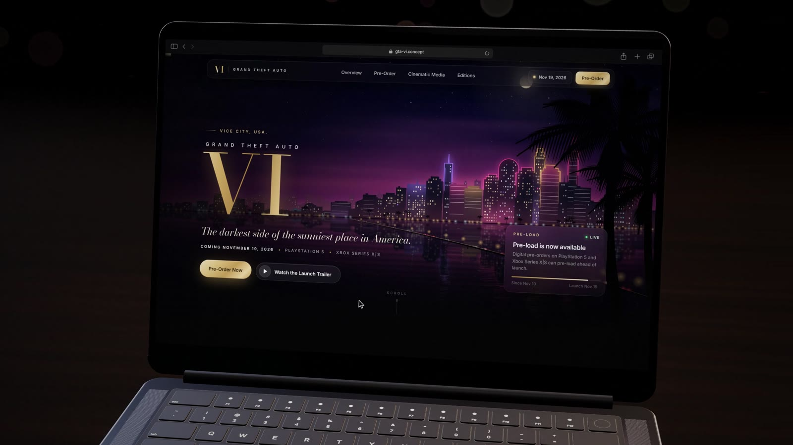

# GTA VI – Luxury Landing Page · MacBook Pro Showcase

Ein flüssiges 60‑fps‑Showcase‑Video (2560 × 1440): Ein MacBook Pro 14″ in Space Gray
steht auf einem dunklen Walnuss‑Designertisch, das Display wacht auf und zeigt eine
ultra‑edle Landingpage für **Grand Theft Auto VI** in Safari (Vollbild, Dark Mode).
Die Kamera fährt langsam auf den Bildschirm zu, während der Cursor über die Seite
gleitet, Hover‑Effekte auslöst und gleichmäßig nach unten scrollt.

> **Inoffizielles Fan‑Konzept** zu Designzwecken – nicht mit Rockstar Games oder
> Take‑Two Interactive verbunden. „Grand Theft Auto“ und „Grand Theft Auto VI“ sind
> Marken von Take‑Two Interactive Software, Inc. Es werden **keine** offiziellen Bilder,
> Logos oder Videos verwendet: Skyline, Palmen, Brücke, Motive und das MacBook sind
> vollständig prozedural (Code) erzeugt.

## Ergebnis



| Datei | Inhalt |
| --- | --- |
| `output/GTA-VI-MacBook-Showcase.mp4` | finales Video: 2560 × 1440, 60 fps, 50 s, H.264 High (BT.709) + Original‑Soundtrack (AAC 192 kbit/s, −14,5 LUFS) |
| `output/GTA-VI-Launch-Film-9x16.mp4` | Motion Graphic für TikTok / Reels / Shorts: 1080 × 1920, 60 fps, 32 s, H.264 + Original‑Soundtrack (−14 LUFS) |
| `site/` | die Landingpage (läuft auch ganz normal im Browser) |
| `scene/` | Three.js‑Szene: MacBook Pro, Tisch, Licht, Kamera |
| `render/` | deterministischer Frame‑Renderer + ffmpeg‑Encoding |

## Die Landingpage

* **Stil:** mattschwarz, Champagner‑Gold, Frosted Glass (Backdrop‑Blur), Typografie
  aus *Inter* (Display‑Optik) und *Bodoni Moda* (Kursiv‑Akzente, Gold‑Verläufe).
* **Navigation:** Overview · Pre‑Order · Cinematic Media · Editions (+ Datum, CTA).
* **Hero:** animierte Vice‑City‑Nacht – spiegelnde Bucht mit Wellen, Neon‑Kronen,
  blinkende Flugwarnlichter, fließender Verkehr auf der Brücke, wiegende Palmen.
* **Sektionen:** Story (scroll‑gekoppelte Wort‑Hervorhebung), Key Features (Bento‑Grid
  mit Cursor‑Spotlight), Only in Leonida, Characters, Cinematic Media (Launch Trailer,
  Reel, Timeline), Editions (Standard / Ultimate), Finale mit Datum, Footer.
* **Animationen:** Masken‑Reveals Wort für Wort, Buchstaben‑Einblendung, Gold‑Shine,
  Hover‑Lift, Gold‑Rahmen, Play‑Ringe, Timeline‑Fill, Datum‑„Odometer“.

Die Seite ist responsiv (Desktop, Tablet, Smartphone); im Video wird die Desktop‑Ansicht
mit 1512 × 906 CSS‑px gezeigt, wie Safari im Vollbild auf einem MacBook Pro 14″.

Alle Animationen sind reine Funktionen von *(Zeit, Scrollposition, Zeiger)*.
Im normalen Browser laufen sie in Echtzeit; mit `?rec` wird die Seite vom Renderer
Frame für Frame gesteuert, deshalb gibt es im Video keinerlei Ruckler oder Drops.

## Soundtrack

Eigens komponiert und vollständig per Code synthetisiert (`render/music.py`, keine Samples,
keine bestehende Musik): nächtlicher Synthwave in d‑Moll, ca. 98,6 BPM – das Tempo ist so
gewählt, dass genau 14 Takte zwischen Scroll‑Start und Finale liegen.

| Zeit | Bild | Ton |
| --- | --- | --- |
| 0 – 1,7 s | MacBook im Dunkeln | tiefer Drone, Nachtluft |
| 1,7 s | Display wacht auf | weicher Swell + gläserner Glocken‑Akkord |
| 10,35 s | Scrollen beginnt | Reverse‑Swell, Beat, Bass und Arpeggio setzen ein |
| ab 29,8 s | Charaktere, Trailer | Lead‑Melodie, offene Hi‑Hats |
| 39,6 – 44,4 s | Editions → Finale | Riser, Snare‑Wirbel, kurze Atempause |
| 44,43 s | „11.19.2026“ rollt ein | Impact (Sub‑Boom, Crash) + breiter Dm9‑Akkord |
| 48,35 – 50 s | Ausblende | Ton blendet synchron aus |

Mix: Sidechain‑Pumpen, Ping‑Pong‑Delays, Hall und Gated‑Plate (80er‑Snare), Master‑EQ
und Glue‑Kompression; zweistufig auf −14,5 LUFS normalisiert (True Peak −1,9 dBFS).

## Motion Graphic „VI — Launch Film“ (9:16)

Vertikaler 32‑Sekunden‑Schnitt für TikTok, Reels und Shorts – Caption: *„Our way to celebrate the
launch of GTA VI“*. 120 BPM, jede Bewegung sitzt auf dem Beat (1 Takt = 2 s):

| Zeit | Bild | Ton |
| --- | --- | --- |
| 0 – 4 s | goldene Glow‑Formen morphen im Beat: Kreis → Sechseck → Dreieck → Raute → **VI**, kinetische Caption | jede Form ein Ton (D5 F5 A5 C6), Akkord‑Hit auf dem VI |
| 4 – 6 s | das VI wird zum Rahmen des Displays, die Kamera fährt zurück, das MacBook geht an | Downlifter, gläserner Glocken‑Akkord |
| 6 – 12,5 s | Tour durch die ganze Website: pro Beat‑Paar ein Scroll‑Whip + eine 3D‑Kamerafahrt, Kapitel 01–07 | Four‑on‑the‑floor, ein Whoosh landet auf jedem Scroll |
| 12,5 – 16 s | der Cursor klickt auf „Launch Trailer“, das Video startet in der Karte, die Kamera taucht ins Display | Filter schließt sich, Klick, Riser, ein Beat Stille |
| 16 – 28 s | echte Nacht‑Footage in morphenden Glow‑Formen (Pille, Kreis, Sechseck, Raute, Dreieck), Fakten als Typo | Drop, Lead‑Melodie, ein Hit pro Schnitt, Build mit Snare‑Roll |
| 28 – 32 s | VI‑Monogramm (Didone‑Konstruktion) mit Stadt‑Footage, Caption, 11.19.2026, Plattformen | Finale‑Hit, Glocken, Ausklang – endet schwarz und loopt |

Technik: `scene/mg.js` (Three.js: das MacBook aus `scene/macbook.js`, Formen als Signed‑Distance‑Fields
mit Glow, Footage‑Compositing, Echo‑Ebenen für die Tiefe), `render/mg_timeline.mjs` (Choreografie als
reine Funktionen der Zeit), `render/render_mg.mjs` (deterministisch, adaptive Bewegungsunschärfe mit
bis zu 6 Subframes bei 180°‑Shutter), `render/music_mg.py` (Score, prozedural).

**Footage** – lizenzfrei, keine Rockstar‑Trailer, kein Gameplay, keine offiziellen Logos:

* Pexels (Pexels License): Videos [6345205](https://www.pexels.com/video/6345205/), [19109600](https://www.pexels.com/video/19109600/),
  [19109604](https://www.pexels.com/video/19109604/), [8576666](https://www.pexels.com/video/8576666/), [40183132](https://www.pexels.com/video/40183132/)
* Mixkit (Mixkit Stock Video Free License): Clips 42042, 12028, 42034

```bash
render/get_footage.sh /tmp/footage && render/prep_footage.sh /tmp/footage   # -> footage/ (git-ignoriert)
node render/render_mg.mjs --out /tmp/mg --stills 2.6,14.6,21,29.6          # Standbilder
node render/render_mg.mjs --out /tmp/mg                                     # alle 1920 Frames
BLOOM=0.18 VIGNETTE=0.45 render/encode.sh /tmp/mg /tmp/mg.mp4 18 0 0
python3 render/music_mg.py /tmp/score_mg.wav
```

### Inhaltliche Quellen (Stand 18. November 2026)

Alle Angaben stammen von Rockstar Games:

* Release **19. November 2026**, PlayStation 5 und Xbox Series X|S –
  [Newswire](https://www.rockstargames.com/newswire/article/ak3ak31a49a221/grand-theft-auto-vi-is-now-set-to-launch-november-19-2026)
* Editionen, Inhalte, Pre‑Order‑Bonus (Vintage Vice City Pack, 1 Monat GTA+ bis 20.11.2026),
  Pre‑Load ab 10.11., Cloud Gaming / Remote Play –
  [Support: Platforms, Editions, and Versions](https://support.rockstargames.com/articles/4QfG4FmZCf5W1gS8jy4UVT/grand-theft-auto-vi-platform-editions-and-versions),
  [Editions](https://www.rockstargames.com/VI/editions)
* *An Extended Look* (27.08.2026, komplett in‑game auf PS5 aufgenommen) –
  [Newswire](https://www.rockstargames.com/newswire/article/4k138k8okkk483/grand-theft-auto-vi-an-extended-look-now-playing)
* Launch Trailer (15.10.2026) mit „Flower in a Hurricane“ (Justice feat. Tame Impala, SZA,
  King Gizzard & The Lizard Wizard), Score von Justice –
  [Newswire](https://www.rockstargames.com/newswire/article/517572321a549a/watch-the-grand-theft-auto-vi-launch-trailer)
* Figuren und Orte – [Only in Leonida](https://www.rockstargames.com/VI/only-in-leonida),
  Timeline – [Newswire‑Archiv](https://www.rockstargames.com/newswire?tag=vi)

Preise werden bewusst nicht gezeigt, da sie je nach Region variieren und keine offizielle
Preisangabe von Rockstar vorlag.

## Selbst ausführen

```bash
cd gta6-showcase
npm install                     # three.js + Schriften
npm run serve                   # http://127.0.0.1:4173/site/  (Landingpage live)

# Video rendern (Playwright/Chromium nötig, CPU‑Rendering via SwiftShader)
node render/render.mjs --out /tmp/frames --w 2560 --h 1440        # alle 3000 Frames
node render/render.mjs --out /tmp/stills --stills 5,17,34,46      # einzelne Standbilder
render/encode.sh /tmp/frames /tmp/video.mp4 18
python3 render/music.py /tmp/score.wav                             # benötigt numpy + scipy
ffmpeg -i /tmp/video.mp4 -i /tmp/score.wav -map 0:v -map 1:a -c:v copy \
  -af loudnorm=I=-14.5:TP=-1.5 -c:a aac -b:a 192k -shortest output/GTA-VI-MacBook-Showcase.mp4
```

* `render/timeline.mjs` – Kamera (Weitwinkel → sanfter Zoom → Rückzug), Display‑Wake,
  Tastaturbeleuchtung; wird von Node *und* Browser genutzt.
* `render/plan.mjs` – Scroll‑Kurve (monotone kubische Interpolation, nie rückwärts)
  und Cursor‑Weg, aus dem gemessenen Layout der Seite berechnet.
* Die Webseite wird in voller Retina‑Auflösung (3024 × 1812) erfasst und scrollt in
  Geräte‑Pixel‑Schritten (0,5 CSS‑px) – exakt wie ein echtes Retina‑Display, ohne Ruckler.
* `scene/scene.js` – prozedurales MacBook Pro 14″ (Space Gray, Tastatur mit
  Hintergrundbeleuchtung, Trackpad, Lautsprechergitter, Notch, Glas), Walnuss‑Tisch mit
  eingebackener Tiefenunschärfe, Studio‑Licht, Display‑Licht in den Farben der Seite.

Schriften: Inter, Inter Tight, Bodoni Moda – SIL Open Font License (siehe `site/assets/fonts`).
